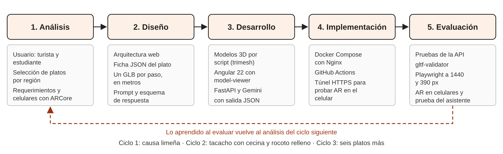
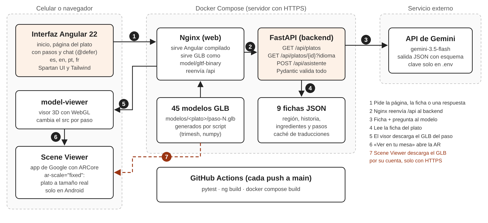
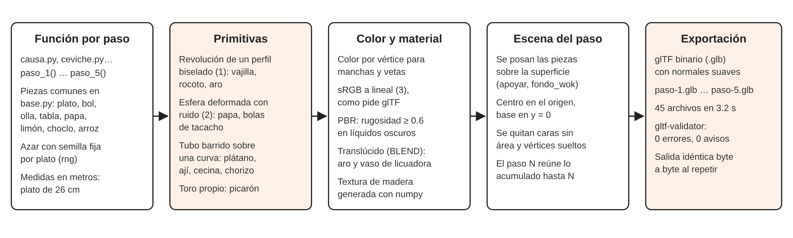
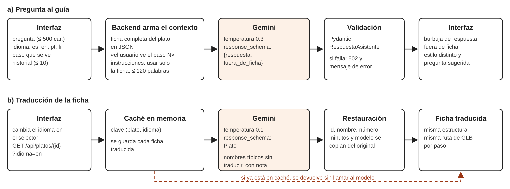
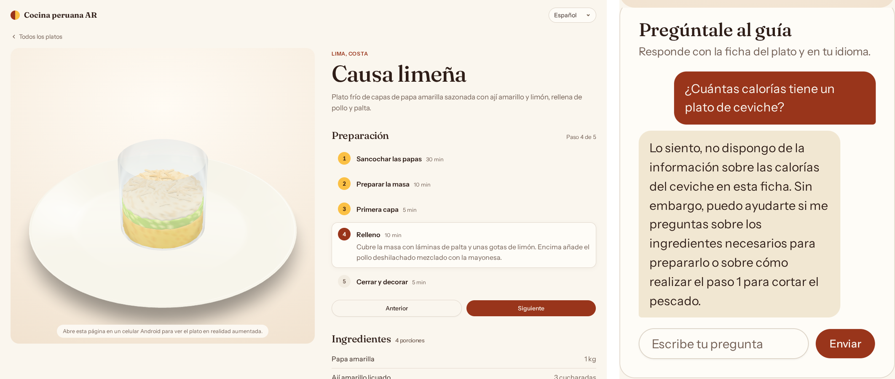
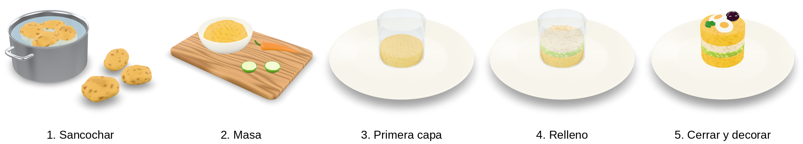
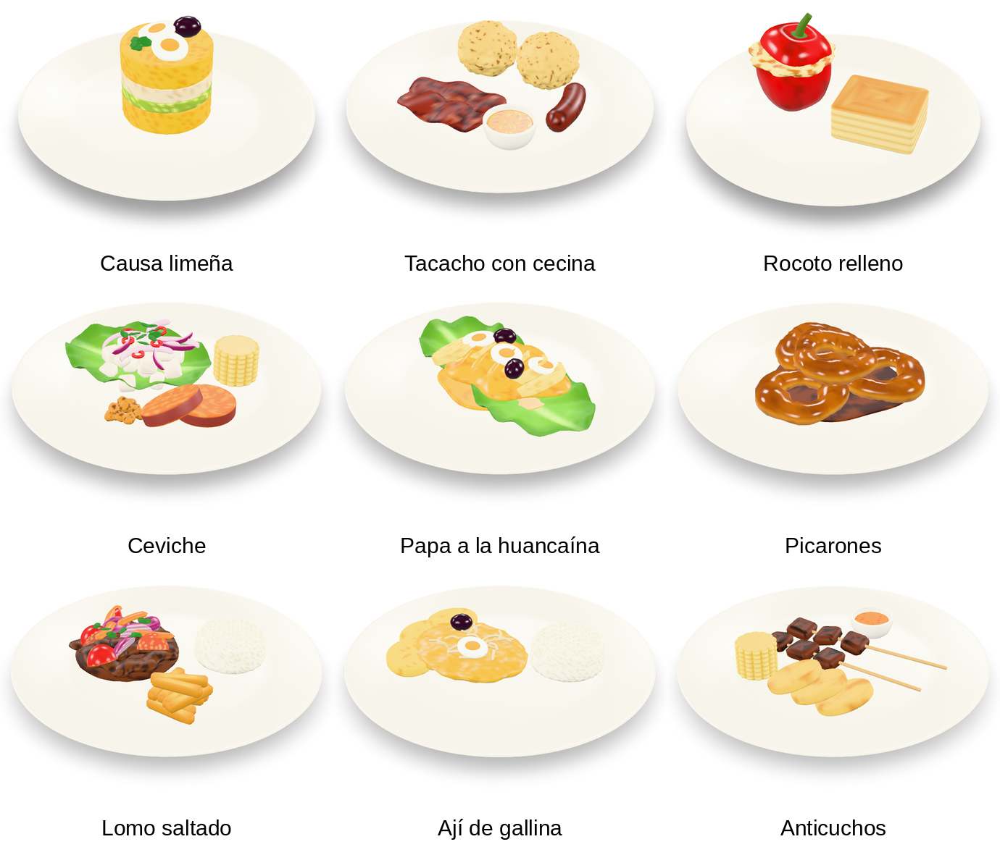

# Guía web de platos peruanos con modelos 3D por paso de receta, realidad aumentada y un asistente de IA limitado a la ficha del plato

**Resumen.** La cocina peruana se difunde sobre todo con fotos del plato terminado, que no muestran cómo se prepara, y los asistentes basados en modelos de lenguaje pueden inventar datos sobre platos que conocen poco. Este trabajo presenta una guía web de nueve platos peruanos que muestra cada paso de la receta con un modelo 3D, permite ver el plato a tamaño real con realidad aumentada en Android sin instalar una aplicación y responde preguntas con un asistente que solo usa la ficha del plato. El desarrollo siguió una adaptación del modelo ADDIE en tres ciclos. Los 45 modelos glTF se generaron por código en 3.2 s, sin errores en gltf-validator, con una mediana de 406 kB y 18 672 triángulos por paso. El asistente se evaluó con 54 preguntas, con y sin la ficha, en cinco modelos de lenguaje. Con la ficha, Gemma 3 12B y Gemini 3.5 Flash-Lite marcaron bien todas las preguntas sin respuesta (F~1~ = 1.00), acertaron todas las palabras clave y no dieron cifras sin respaldo; sin la ficha, Gemma 3 12B dio cifras inventadas en la mitad de las preguntas sin respuesta. La traducción conservó el 98.1 % de los nombres típicos y todas las cantidades. La realidad aumentada funcionó en un celular certificado para ARCore y falló en uno que no lo está. Falta una evaluación con usuarios.

**Palabras clave.** gastronomía peruana, patrimonio culinario, realidad aumentada, modelos 3D procedurales, glTF, modelos de lenguaje de gran tamaño, asistente conversacional, aplicación web

**Abstract.** Peruvian cuisine is mostly shared through photos of the finished dish, which do not show how it is prepared, and assistants based on language models may invent facts about dishes they know little about. This work presents a web guide to nine Peruvian dishes that shows each recipe step as a 3D model, places the dish at real size on the table with augmented reality on Android without installing an app, and answers questions with an assistant restricted to the dish record. Development followed an adapted ADDIE model in three cycles. The 45 glTF models were generated by code in 3.2 s, with no gltf-validator errors and a median of 406 kB and 18 672 triangles per step. The assistant was evaluated with 54 questions, with and without the record, on five language models. With the record, Gemma 3 12B and Gemini 3.5 Flash-Lite flagged every unanswerable question (F~1~ = 1.00), matched all keywords and gave no unsupported figures; without it, Gemma 3 12B invented figures in half of the unanswerable questions. Translation kept 98.1 % of the traditional names and every quantity. Augmented reality worked on an ARCore-certified phone and failed on an uncertified one. A user study is still pending.

**Keywords.** Peruvian cuisine, culinary heritage, augmented reality, procedural 3D models, glTF, large language models, conversational assistant, web application

## I. Introducción

La gastronomía peruana dejó de ser un hecho familiar para convertirse en patrimonio de la nación y en un atractivo turístico que hoy complementa la oferta monumental del país, como Machu Picchu [1]. Visitantes de Lima que valoraron su experiencia, incluida la cocina tradicional limeña, mostraron mayor intención de volver y de recomendar el destino [2]. Parte de ese prestigio lo construyeron chefs que, al volver del extranjero, conservaron elementos del sistema culinario local como base de sus creaciones [3]. En 2023 la UNESCO inscribió las prácticas y significados asociados a la preparación y el consumo del ceviche en la Lista Representativa del Patrimonio Cultural Inmaterial de la Humanidad [4]. La misma visibilidad trae tensiones: la cocina tradicional funciona como espacio de memoria e identidad, pero también sufre procesos de gentrificación que desplazan a sus actores [5].

La difusión digital de esa cocina se apoya sobre todo en imágenes. Especialistas peruanos con más de cinco años en el sector señalan la narrativa, el color, la composición, el encuadre y la luz como los recursos de la fotografía gastronómica en redes sociales [6], y en Colombia los restaurantes tradicionales promueven su cocina con estrategias de contenido en esas mismas plataformas [7]. Una foto muestra el plato terminado, no cómo se arma. Preservar una receta tradicional exige documentarla con cuidado, llevarla a la educación y apoyarse en tecnologías digitales [8], y ya se ha propuesto la realidad aumentada (AR) para archivar platos tradicionales en un entorno digital [9].

La AR superpone contenido digital a la vista del entorno real y se usa en patrimonio cultural para guiar visitantes, reconstruir objetos en 3D y crear experiencias educativas [10], [11]. Frente a un mapa impreso, una guía con AR mejoró el aprendizaje cultural en un pueblo histórico de China [12]. En el Perú, una aplicación con modelos 3D de culturas preincas subió en 33.07 % las notas de escolares de tercer grado [13], y en el museo Wariwilca de Huancayo el 82.30 % de los estudiantes reportó una experiencia positiva [14]. Su alcance depende del dispositivo y del presupuesto: las instituciones con pocos recursos necesitan soluciones de bajo costo y con guía para usuarios poco familiarizados con la AR [15]. Los marcos de AR móvil no reconocen igual de bien los objetos en un entorno real [16], y la AR sin marcadores en Android exige un celular certificado para ARCore, cuya lista publica Google modelo por modelo [17].

En la cocina, la AR se ha probado en menús y en la enseñanza. ARoma mostró platos indios en 3D con su historia y su aroma, y en un estudio con 30 participantes mejoró la experiencia frente al menú impreso [18]. En un curso de cocina continental, un producto de AR obtuvo una validez de 0.93 y una practicidad de 80.53 % [19]. Con gafas de AR, 20 novatos siguieron una receta sin apartar las manos de los ingredientes [20], y un asistente de cocina sobre un visor Magic Leap con tutoriales paso a paso fue recomendado por 19 de 20 participantes [21]. HukAD reconoce 18 ingredientes de la cocina butuanon y muestra en 3D los platos que se pueden preparar con ellos [22].

Los modelos de lenguaje de gran tamaño (LLM) pueden acompañar estas experiencias. En una cocina real, los usuarios de un asistente basado en un LLM valoraron que adaptara las instrucciones y diera información más allá de la receta [23], y Azzurra ancla las respuestas de un avatar a la Enciclopedia de la Cocina Italiana [24]. El riesgo es conocido: un LLM puede generar contenido verosímil pero falso, lo que se denomina alucinación [25]. En comida ese riesgo tiene sesgo cultural. Los LLM saben más de la cocina de Estados Unidos que de otras [26], al adaptar recetas a otra cocina preservan poco la autenticidad [27], y con platos peruanos el mejor modelo evaluado acertó las calorías solo en 45 % de los casos [28]. Traducir una receta tampoco es solo cambiar palabras, porque exige adaptar ingredientes y técnicas a otra cultura [29].

El objetivo de este trabajo fue desarrollar una guía web de platos peruanos que muestra cada paso de la receta con un modelo 3D, permite ver el plato sobre la mesa con AR desde un celular Android y responde preguntas con un asistente de IA que solo usa la ficha del plato y la traduce a otros idiomas. Para ello se plantearon cuatro objetivos específicos: (a) documentar nueve platos de distintas regiones en fichas estructuradas; (b) generar por código un modelo glTF por cada paso de cada receta, a tamaño real y apto para celulares; (c) integrar un asistente que responda a partir de la ficha y marque las preguntas que la ficha no responde; y (d) evaluar el prototipo con pruebas funcionales, la validación de los modelos, la prueba de AR en celulares y una evaluación del asistente con y sin la ficha. El objetivo (a) se cubre en la sección III-C, el (b) en las secciones III-E y IV-B, y los objetivos (c) y (d) en la sección IV.

## II. Estado del arte

La búsqueda se hizo en Scopus con términos sobre realidad aumentada, modelos 3D, enseñanza de recetas, cocina tradicional y peruana, patrimonio culinario y modelos de lenguaje aplicados a la comida. Devolvió 112 registros, casi todos de 2020 a 2026. Se descartaron los que no trataban AR, modelos de lenguaje ni gastronomía, como los de enseñanza de vocabulario, gestos o fatiga de conductores. Quedaron 34, repartidos en tres líneas: AR y 3D aplicados a la comida, AR en patrimonio y turismo, y modelos de lenguaje en cocina y cultura. La Tabla I resume los más cercanos.

**Tabla I.** Trabajos relacionados {ancha} {anchos=14,15,13,13,13,14,6,6,6}

| Ref. | Ámbito y usuarios | Plataforma | Contenido | Validación | Resultado clave | Pasos de receta | Asistente LLM | Web sin instalar |
|---|---|---|---|---|---|---|---|---|
| [9] Solmaz y Pekerşen | Platos tradicionales turcos, clientes de restaurante | App móvil | Plato en 3D | Entrevistas, 30 clientes | Sorpresa e interés por el 3D | No | No | No |
| [18] ARoma | Cocina india, comensales | App móvil y dispositivo de aroma | Plato en 3D, historia y nutrición | Dos grupos, 30 personas | Mejora frente al menú impreso | No | No | No |
| [19] Dewi et al. | Curso de cocina continental | App de AR | Material del curso | 5 expertos y 17 estudiantes | Validez 0.93, practicidad 80.53 % | Parcial | No | No |
| [20] Yeh y Lin | Novatos en cocina | Gafas de AR | Texto de la receta | SUS y NPA, 20 personas | Mejor desempeño que con tableta | Sí | No | No |
| [21] Majil et al. | Cocina doméstica | Magic Leap One | Tutoriales y YOLOv5 | 20 participantes | 19 de 20 lo recomiendan | Sí | No | No |
| [22] HukAD | Cocina butuanon, Filipinas | Unity y ARCore | YOLOv8, 18 ingredientes | ISO 9241-110, 300 personas | Media 3.98 de 5 | No | No | No |
| [30] Sari et al. | Comida de Java Occidental | Medio de AR | Historia y nutrición | Expertos de medio y contenido | Categoría «muy bueno» | No | No | No |
| [13] Cabanillas et al. | Culturas preincas, escolares | App móvil | Modelos 3D | Cuasiexperimento, 84 alumnos | +33.07 % en notas | No | No | No |
| [14] Lapa et al. | Museo Wariwilca, Huancayo | App móvil | Objetos en 3D | Encuesta antes y después | 82.30 % experiencia positiva | No | No | No |
| [33] Cheng et al. | Ciencias, niños | App móvil | AR y personaje con LLM | Experimento, N = 50 | Respuestas más pertinentes con LLM | No | Sí | No |
| [34] ARFood | Nutrición, generación alfa | Juego de AR | Personajes con IA | 93 participantes, 83 carritos | Cubre los objetivos tras ajustar prompts | No | Sí | No |
| [24] Azzurra | Cocina italiana | Web y holograma | Avatar con LLM y enciclopedia | Feria con público | Respuestas ancladas a la fuente | No | Sí | Sí |
| [28] Carrillo-Larco et al. | Platos peruanos | Gemma 3 (4B, 12B, 27B) | Foto y nombre del plato | 510 almuerzos de un recetario | 45 % de acuerdo en calorías | No | Sí | No aplica |
| Este trabajo | Nueve platos peruanos, turistas y estudiantes | Web, model-viewer y Scene Viewer | 45 modelos 3D por paso y ficha | Pruebas, validador, celulares, 54 preguntas | Con la ficha, F~1~ = 1.00 y 0 % de cifras sin respaldo | Sí | Sí | Sí |

### A. Realidad aumentada y modelos 3D en la comida

Solmaz y Pekerşen llevaron platos tradicionales a una aplicación móvil y la probaron con 30 clientes de restaurantes tradicionales, que dijeron sorprenderse al ver los platos en 3D [9]. ARoma sumó la historia, la nutrición y un dispositivo de aroma, y en dos grupos de 15 personas superó al menú impreso [18]; Sari et al. hicieron algo parecido con la comida de Java Occidental [30]. En la enseñanza, Dewi et al. siguieron el modelo ADDIE para un curso de cocina continental [19], y Yeh y Lin compararon gafas de AR con una tableta en 20 novatos [20]. El antecedente más cercano a una guía paso a paso es el de Majil et al., que reconoce ingredientes con YOLOv5 y muestra tutoriales en un visor Magic Leap One [21]. HukAD usa YOLOv8 con Unity y ARCore, y 300 personas le dieron 3.98 sobre 5 [22]. En el Perú, la cocina se ha trabajado con visión por computadora: PeruFoodNet reúne 4 000 imágenes de 40 platos [31] y otro proyecto responde preguntas visuales sobre platos peruanos en el español de cada región [32]. Ninguno muestra cómo cambia el plato de un paso a otro, y los que usan AR se instalan como aplicación o necesitan un visor.

### B. Realidad aumentada en patrimonio y turismo

La AR se usa en patrimonio para guiar, reconstruir y enseñar [10], y una revisión de 64 aplicaciones móviles identificó 16 patrones de diseño recurrentes [11]. En el Perú hay aplicaciones con AR para culturas preincas [13], para el museo Wariwilca [14] y para el turismo en la Reserva Nacional Pacaya Samiria, donde la evaluación con el cuestionario UEQ destacó la inmersión y señaló problemas técnicos y de pertinencia cultural [35]. Las instituciones con poco presupuesto usan software y alojamiento gratuitos y procuran guiar al usuario [15]. Todas son aplicaciones que se instalan, y ninguna trata la cocina.

### C. Modelos de lenguaje en la cocina y la cultura

Mango Mango es un asistente de cocina basado en un LLM. Sus usuarios valoraron las instrucciones adaptadas al contexto, pero pidieron que fuera más proactivo [23]. Cheng et al. combinaron AR, narrativa china y un LLM para enseñar ciencias, y en un experimento con 50 niños el grupo con LLM escribió respuestas más pertinentes que el de diálogos fijos [33]. En ARFood, dos personajes con IA evalúan carritos de compra virtuales, y sus prompts se ajustaron hasta cubrir todos los objetivos educativos [34]. Hutson advierte que combinar LLM y tecnologías inmersivas puede comprometer la veracidad histórica, y propone trabajar con expertos [36]. Azzurra resuelve parte de ese riesgo con una base de conocimiento validada y salvaguardas por dominio [24]. Del lado de la evaluación, FMLAMA muestra el sesgo de los LLM hacia la comida de Estados Unidos [26], ASH mide la autenticidad en 4 800 recetas adaptadas [27], LLaVA-Chef genera recetas a partir de imágenes [37] y Carrillo-Larco et al. compararon contra un recetario la nutrición que estimaron tres modelos Gemma para 510 platos peruanos [28]. En ninguno el modelo queda limitado a una ficha del plato, y tampoco se mide si inventa cifras cuando la fuente no trae la respuesta.

### D. Síntesis y brecha

De la Tabla I salen tres vacíos. Los trabajos de AR en comida presentan el plato terminado o el texto de la receta, pero no un modelo 3D por paso. Además, todos se instalan como aplicación o necesitan un visor, mientras que el patrimonio pide soluciones de bajo costo [15]. Por último, los que usan un LLM no miden qué hace el modelo ante una pregunta que su fuente no responde. Este trabajo atiende los tres en escala de prototipo. No reconoce ingredientes con cámara, no tiene voz y todavía no tiene una evaluación con usuarios.

## III. Materiales y métodos

### A. Metodología de desarrollo

El desarrollo siguió una adaptación del modelo ADDIE, cuyas fases son Análisis, Diseño, Desarrollo, Implementación y Evaluación [38], el mismo que usaron Dewi et al. para su material de AR culinaria [19]. Se trabajó en tres ciclos (Fig. 1). El primero cubrió un solo plato, la causa limeña, elegida porque sus pasos se apilan en capas y su geometría es simple. El segundo sumó el tacacho con cecina y el rocoto relleno, de la selva y la sierra. En el tercero entraron seis platos más. Lo aprendido al evaluar cada ciclo volvía al análisis del siguiente; así se cambió, por ejemplo, el aro de acero de la causa por uno translúcido.

 {ancha}

**Fig. 1.** Fases de ADDIE aplicadas al desarrollo, en tres ciclos.

### B. Análisis de requerimientos

Se definieron dos usuarios: el turista que no conoce un plato y el estudiante que quiere aprender a prepararlo. Ambos usan un celular común, y muchos no hablan español. De ese perfil salen los requerimientos de la Tabla II. Los que más pesaron fueron no instalar nada, ver el estado del plato en cada paso y que el asistente no invente datos. La Tabla III recoge las tecnologías.

**Tabla II.** Requerimientos funcionales {anchos=12,28,60}

| Código | Requerimiento | Descripción |
|---|---|---|
| RF01 | Catálogo | Lista de platos con región, resumen y modelo del plato servido. |
| RF02 | Receta por pasos | Cada paso muestra su modelo 3D, título, descripción y duración. |
| RF03 | Visor 3D | Girar y acercar el modelo con el dedo o el ratón. |
| RF04 | Realidad aumentada | Ver el plato sobre la mesa a tamaño real desde Android. |
| RF05 | Ficha | Historia, porciones e ingredientes con cantidades. |
| RF06 | Asistente | Responder con la ficha y avisar cuando la pregunta está fuera de ella. |
| RF07 | Idiomas | Interfaz y ficha en español, inglés, portugués y francés. |
| RF08 | Despliegue | Construcción y pruebas automáticas en contenedores. |

**Tabla III.** Tecnologías del sistema {anchos=28,72}

| Capa | Tecnología |
|---|---|
| Interfaz | Angular 22 sin zone.js, con signals; Spartan UI y Tailwind |
| Visor y AR | model-viewer 4.4, Scene Viewer con ARCore |
| Modelos 3D | Python con trimesh, numpy y Pillow; glTF 2.0 binario |
| Servidor | FastAPI con Pydantic |
| Asistente | API de Gemini (gemini-3.5-flash) con salida JSON |
| Despliegue | Docker Compose con Nginx; GitHub Actions |
| Pruebas | pytest, gltf-validator, Playwright |

### C. Selección de platos y fichas

Se eligieron nueve platos que cubren costa, sierra y selva, y distintos momentos de la comida: causa limeña, ceviche, papa a la huancaína, rocoto relleno (Arequipa), tacacho con cecina (San Martín), lomo saltado, ají de gallina, anticuchos y picarones. Cada plato tiene una ficha JSON con región, resumen, historia, porciones, ingredientes con cantidad y cinco pasos con título, descripción, duración en minutos y la ruta de su modelo. La ficha es la única fuente del asistente. Los orígenes que no tienen un respaldo documental firme, como el del nombre de la causa o la leyenda del rocoto relleno, se redactaron como versiones populares y no como hechos.

### D. Arquitectura

La Fig. 2 muestra la arquitectura. La interfaz, hecha en Angular, pide al servidor la lista de platos y la ficha de cada uno (1). Nginx sirve la interfaz compilada y los modelos, y reenvía las rutas /api al servidor FastAPI (2). Para responder, el servidor lee la ficha (4) y se la envía a Gemini junto con la pregunta (3). El visor descarga el modelo del paso que se está viendo (5), y el botón «Ver en tu mesa» abre la AR (6). En Android, model-viewer delega la AR en Scene Viewer, la aplicación de Google que usa ARCore, y esta descarga el modelo por su cuenta (7). Por eso la AR solo funciona si el sitio tiene una dirección pública con HTTPS. El atributo ar-scale="fixed" impide que el usuario cambie la escala, así que el plato aparece a 100 % de su tamaño [39]. La clave de Gemini vive solo en el servidor.

 {ancha}

**Fig. 2.** Arquitectura del sistema. Las flechas numeradas siguen el orden del texto; en línea discontinua, la descarga que hace Scene Viewer.

### E. Modelado 3D procedural

Los 45 modelos se generan por código y no se modelaron a mano ni se escanearon (Fig. 3). Cada plato tiene un archivo con una función por paso, y las piezas que se repiten, como el plato, la tabla, el bol, la olla, la papa, el limón o el choclo, están en un módulo común. Todo se arma en metros, con el centro en el origen y la base apoyada, porque glTF usa el metro como unidad [40]; el plato servido mide 26 cm. La vajilla, el aro y el rocoto son sólidos de revolución: un perfil con bordes redondeados (radio *r* y altura *z* en función de un parámetro *t*) gira alrededor del eje vertical en 64 secciones, con φ entre 0 y 2π:

$$
S(t,\varphi)=\bigl(r(t)\cos\varphi,\; r(t)\sin\varphi,\; z(t)\bigr)\tag{1}
$$

Para que una papa o una bola de tacacho no parezcan esferas perfectas, cada vértice se desplaza con un ruido suave formado por tres octavas de sinusoides en cinco direcciones aleatorias:

$$
n(\mathbf{p})=\operatorname{clip}\!\left(\kappa\sum_{o=0}^{2}w_o\sum_{j=1}^{5}\sin\!\left(\frac{2^{o}\,2\pi}{\lambda}\,\mathbf{d}_{oj}\cdot\mathbf{p}+\phi_{oj}\right),-1,1\right)\tag{2}
$$

donde **p** es la posición del vértice, λ el ancho de las manchas en metros, **d**~oj~ y φ~oj~ son una dirección unitaria y una fase aleatorias, *w*~o~ = 2^−o^ y κ normaliza la suma para que ocupe el rango de −1 a 1. El vértice de una esfera de radios **R** en la dirección unitaria **u** pasa a

$$
\mathbf{v}'=\mathbf{u}\odot\mathbf{R}+a\,n(\mathbf{u}\odot\mathbf{R})\,\mathbf{u}\tag{3}
$$

donde *a* es la amplitud del bulto y ⊙ el producto elemento a elemento. El plátano, el ají, la cecina y el chorizo son tubos barridos sobre una curva suave, y el picarón es un toro. Las mismas funciones de ruido pintan manchas y vetas con color por vértice. glTF espera los colores en espacio lineal [40], así que cada color definido en sRGB se convierte con la aproximación gamma

$$
c_{lin}=c_{sRGB}^{\,2.2}\tag{4}
$$

donde *c* es cada canal entre 0 y 1; la curva exacta del estándar sRGB tiene un tramo lineal cerca del negro [41]. Cada pieza lleva un material PBR con rugosidad y opacidad propias, y el aro y el vaso de la licuadora son translúcidos. El azar de cada plato sale de una semilla fija, así que dos ejecuciones producen archivos idénticos. La escena del paso *N* reúne lo que se lleva preparado hasta ese paso, y se exporta en glTF binario con sus normales para que el visor la sombree suave.

 {ancha}

**Fig. 3.** Proceso de generación de los modelos 3D, desde la función de cada paso hasta el archivo GLB.

### F. Interfaz y visor

La página del plato pone el visor a la izquierda y los pasos a la derecha; en el celular, el visor queda arriba. Cambiar de paso solo cambia el atributo src del visor, y el modelo del paso siguiente se descarga antes de que el usuario lo pida. El chat se carga cuando el usuario llega a él, con un bloque diferido de Angular. El visor usa los modos de AR en este orden: WebXR, Scene Viewer y Quick Look [39]. En la práctica se probó Scene Viewer, porque WebXR en Chrome también necesita ARCore y Quick Look requiere un iPhone. Si la AR falla, la página lo dice.

### G. Asistente y traducción

La Fig. 4a muestra el flujo de una pregunta. El servidor arma el contexto con la ficha completa en JSON, el paso que el usuario está viendo y hasta diez mensajes previos. Las instrucciones de sistema le piden al modelo responder solo con la ficha, en el idioma del usuario, en texto plano y en 120 palabras como máximo, y, si la respuesta no está en la ficha, decirlo, marcar fuera_de_ficha y sugerir otra pregunta. La salida estructurada de Gemini obliga a que la respuesta siga un esquema JSON [42], que el servidor valida con Pydantic; la temperatura es 0.3.

La traducción (Fig. 4b) le pide al modelo traducir la ficha entera y dejar sin traducir los nombres de platos e ingredientes típicos, con una explicación breve la primera vez. Como el esquema de salida es el mismo de la ficha, el servidor copia del original el identificador, el nombre, el número de cada paso, sus minutos y la ruta de su modelo, por si el modelo los altera. Cada traducción queda en memoria con la clave (plato, idioma).

 {ancha}

**Fig. 4.** Flujo del asistente: (a) respuesta a una pregunta y (b) traducción de la ficha.

### H. Despliegue

El sistema se empaqueta con Docker Compose en dos contenedores, web y backend. En cada envío a la rama principal, GitHub Actions corre las pruebas del servidor, compila la interfaz y construye las imágenes. Para probar la AR desde el celular sin desplegar se usó un túnel HTTPS hacia el contenedor web.

### I. Diseño de la evaluación

La evaluación tuvo cinco partes: pruebas funcionales de la API y de la interfaz, validación de los modelos con gltf-validator, prueba de AR en celulares reales, evaluación del asistente y evaluación de la traducción. Para el asistente se armaron 54 preguntas, seis por plato. Cuatro tienen respuesta en la ficha (una cantidad, un paso, un dato de la historia y una pregunta en inglés, portugués o francés), y cada una lleva grupos de palabras clave que la respuesta debe contener. Las otras dos piden algo que la ficha no tiene, como calorías, precios, restaurantes o tiempos de conservación. Cada pregunta se hizo en dos condiciones: con la ficha, por el mismo código del servidor, y sin ella, con las mismas reglas pero sin el contenido de la ficha. Se probaron cinco modelos: Gemini 3.5 Flash, el de la aplicación; Gemini 3.5 Flash-Lite, y tres modelos abiertos servidos con Ollama en una GPU local (Gemma 3 12B, Llama 3.1 8B y Qwen 3.5 4B).

La marca fuera_de_ficha se trató como una clasificación, con las preguntas sin respuesta como clase positiva:

$$
P=\frac{VP}{VP+FP},\qquad R=\frac{VP}{VP+FN},\qquad F_1=\frac{2PR}{P+R}\tag{5}
$$

donde *VP* son las preguntas sin respuesta que el asistente marcó como fuera de ficha, *FP* las que tenían respuesta y marcó igual, y *FN* las que no tenían respuesta y no marcó. Para las que tienen respuesta, la exactitud de claves es

$$
A_{clave}=\frac{1}{|D|}\sum_{q\in D}\prod_{g\in G_q}\mathbb{1}\!\left[\exists\,k\in g:\;k\subseteq y_q\right]\tag{6}
$$

donde *D* es el conjunto de preguntas con respuesta, *G*~q~ los grupos de claves de la pregunta *q*, *y*~q~ la respuesta normalizada sin tildes ni mayúsculas y 𝟙 vale 1 si la condición se cumple. Para medir las cifras inventadas, *N*(·) es el conjunto de números que aparecen en un texto, y la tasa de respuestas con cifras sin respaldo es

$$
T_{cif}=\frac{1}{|Q|}\sum_{q\in Q}\mathbb{1}\!\left[N(y_q)\setminus\bigl(N(f_q)\cup N(x_q)\bigr)\neq\varnothing\right]\tag{7}
$$

donde *Q* es el conjunto evaluado, *f*~q~ la ficha del plato y *x*~q~ la pregunta. Se calcula por separado en las preguntas con respuesta y en las que no la tienen. También se registró si la respuesta estaba en el idioma pedido y la latencia de cada llamada. En la traducción se midió la proporción de nombres típicos que siguieron sin traducir, la de números de la ficha que se conservaron, si la estructura quedó igual y la latencia con y sin caché.

## IV. Resultados

### A. Pruebas funcionales

La Tabla IV resume las pruebas. Las 17 pruebas del servidor pasan en 0.66 s: cubren la lista y el orden de los platos, el detalle de los nueve con sus cinco pasos y modelos, el plato inexistente, el asistente sin clave, la pregunta vacía, la traducción y el idioma no soportado, con el modelo de lenguaje simulado. La interfaz compila en 3.8 s; la carga inicial pesa 308 kB, 82 kB comprimidos, y el visor de model-viewer va en un bloque aparte de 254 kB comprimidos que se descarga al abrir un plato. Con Playwright se recorrieron el inicio y los cinco pasos de cada plato a 1440 y 390 px, sin desplazamiento horizontal ni respuestas con error (Fig. 5).

**Tabla IV.** Pruebas funcionales {anchos=40,60}

| Prueba | Resultado |
|---|---|
| Pruebas del servidor (pytest) | 17 de 17 en 0.66 s |
| Compilación de la interfaz | 3.8 s; inicial 308 kB (82 kB comprimidos) |
| Recorrido con Playwright, 1440 y 390 px | 9 platos × 5 pasos sin desborde horizontal |
| Integración continua | pytest, ng build y docker compose build |
| AR en Redmi Note 14 (ARCore certificado) | Scene Viewer abre el plato a tamaño real |

 {ancha}

**Fig. 5.** Página de la causa limeña en el paso 4 (escritorio) y respuesta del asistente a una pregunta fuera de ficha en el celular.

### B. Modelos 3D

Los 45 modelos se generaron en 3.2 s con 136 MB de memoria, y una segunda ejecución produjo archivos idénticos byte a byte (mismo sha256). gltf-validator no reportó errores, avisos ni mensajes informativos en ninguno. La Tabla V los resume por plato. Cada paso pesa entre 104 y 806 kB (mediana 406 kB) y tiene entre 4 704 y 39 936 triángulos (mediana 18 672); un plato completo con sus cinco pasos pesa entre 1.6 y 2.4 MB. Todos traen normales, y 582 de sus 917 primitivas usan color por vértice. La Fig. 6 muestra los cinco pasos de la causa y la Fig. 7, el último paso de cada plato.

**Tabla V.** Modelos 3D por plato (cinco pasos cada uno) {anchos=30,16,30,12,12}

| Plato | Peso total | Triángulos por paso | Materiales máx. | Translúcidos |
|---|---|---|---|---|
| Causa limeña | 2.0 MB | 7 936 – 28 288 | 8 | 3 |
| Tacacho con cecina | 1.7 MB | 5 184 – 23 904 | 6 | 0 |
| Rocoto relleno | 2.0 MB | 13 992 – 29 288 | 6 | 1 |
| Ceviche | 2.2 MB | 8 520 – 36 624 | 7 | 2 |
| Papa a la huancaína | 2.2 MB | 14 496 – 39 936 | 9 | 2 |
| Picarones | 1.5 MB | 8 528 – 18 680 | 6 | 3 |
| Lomo saltado | 2.2 MB | 8 328 – 34 360 | 9 | 1 |
| Ají de gallina | 2.4 MB | 14 944 – 27 616 | 7 | 1 |
| Anticuchos | 1.8 MB | 4 704 – 26 528 | 8 | 0 |
| Total (45 GLB) | 18.0 MB | 842 028 en total | — | 13 |

 {ancha}

**Fig. 6.** Los cinco modelos de la causa limeña, uno por paso de la receta.

**Fig. 7.** Último paso de los nueve platos, renderizado con model-viewer.

### C. Realidad aumentada en celulares

La AR se probó con el sitio expuesto por un túnel HTTPS (Tabla VI). En un Redmi Note 13 Pro con Android 10 y Chrome 156, Scene Viewer se abría y se cerraba de inmediato. Los modelos pasaban el validador y el registro de Nginx no mostraba ninguna descarga desde Scene Viewer, de modo que el fallo ocurría antes de pedir el archivo. Ese modelo no figura en la lista de ARCore; de la serie Note 13 solo aparece el Pro+ [17]. En un Redmi Note 14, que sí figura, el plato apareció sobre la mesa a tamaño real. El celular de un tercer usuario tampoco abrió la AR, y no se pudo registrar su modelo. En los celulares que fallan, la interfaz muestra un aviso.

**Tabla VI.** Prueba de AR en celulares Android {anchos=30,25,45}

| Celular | En la lista de ARCore [17] | Resultado |
|---|---|---|
| Redmi Note 13 Pro | No | Scene Viewer se cierra antes de descargar el modelo |
| Redmi Note 14 | Sí | Plato sobre la mesa a tamaño real |
| Celular de un tercer usuario | Sin registrar | No abre la AR |

### D. Asistente

La Tabla VII resume las respuestas por modelo y condición. Con la ficha, Gemma 3 12B y Gemini 3.5 Flash-Lite tuvieron F~1~ = 1.00 y exactitud de claves de 1.00, y ninguna respuesta trajo cifras que no estuvieran en la ficha o en la pregunta. Gemini 3.5 Flash, el modelo de la aplicación, logró lo mismo en las 19 preguntas que alcanzó a responder antes de agotar la cuota gratuita diaria de la API. Llama 3.1 8B no marcó una pregunta sin respuesta: a «¿dónde venden los mejores picarones de Lima?» contestó con las ferias y la procesión del Señor de los Milagros que menciona la ficha, sin decir que no puede elegir un lugar. Qwen 3.5 4B marcó como fuera de ficha tres preguntas que sí tenían respuesta, y las tres trataban orígenes que la ficha presenta como versiones populares; aun así respondió con el contenido de la ficha.

**Tabla VII.** Asistente con ficha y sin ficha (54 preguntas: 36 con respuesta y 18 sin respuesta) {ancha} {anchos=17,10,6,8,8,8,10,10,10,8,9}

| Modelo | Condición | n | P | R | F~1~ | A~clave~ | T~cif~ con resp. | T~cif~ sin resp. | Idioma | Latencia media (s) |
|---|---|---|---|---|---|---|---|---|---|---|
| Gemini 3.5 Flash | Con ficha | 19 | 1.00 | 1.00 | 1.00 | 1.00 | 0 % | 0 % | 100 % | 15.22 |
| Gemini 3.5 Flash-Lite | Con ficha | 54 | 1.00 | 1.00 | 1.00 | 1.00 | 0 % | 0 % | 98.1 % | 1.05 |
| Gemini 3.5 Flash-Lite | Sin ficha | 45 | 0.91 | 0.71 | 0.80 | 0.74 | 9.7 % | 7.1 % | 100 % | 1.14 |
| Gemma 3 12B | Con ficha | 54 | 1.00 | 1.00 | 1.00 | 1.00 | 0 % | 0 % | 100 % | 3.19 |
| Gemma 3 12B | Sin ficha | 54 | 1.00 | 0.06 | 0.11 | 0.50 | 27.8 % | 50.0 % | 100 % | 4.09 |
| Llama 3.1 8B | Con ficha | 54 | 1.00 | 0.94 | 0.97 | 0.94 | 0 % | 0 % | 96.3 % | 1.42 |
| Llama 3.1 8B | Sin ficha | 54 | 0.80 | 0.22 | 0.35 | 0.25 | 2.8 % | 33.3 % | 94.4 % | 2.16 |
| Qwen 3.5 4B | Con ficha | 54 | 0.86 | 1.00 | 0.92 | 0.94 | 0 % | 0 % | 96.3 % | 1.11 |
| Qwen 3.5 4B | Sin ficha | 54 | 0.86 | 0.33 | 0.48 | 0.28 | 11.1 % | 38.9 % | 100 % | 1.45 |

Sin la ficha, todos los modelos marcaron menos preguntas como fuera de su alcance y contestaron igual. Gemma 3 12B reconoció 1 de las 18 preguntas sin respuesta. En las otras dio cifras en la mitad de los casos: entre 200 y 450 calorías para una porción de causa, un precio de 25 a 50 soles en restaurantes de Lima y entre 400 y 800 mg de sodio en el ají de gallina, ninguna con fuente. Llama 3.1 8B y Qwen 3.5 4B inventaron cifras en un tercio de esas preguntas o más. Gemini 3.5 Flash-Lite fue el más prudente sin la ficha (R = 0.71, 7.1 %), aunque 9 de sus 54 respuestas sin ficha no se registraron porque la cuota se agotó. Sin la ficha también bajó la exactitud de claves, de 0.94–1.00 a 0.25–0.74, porque los modelos respondían con datos genéricos del plato y no con los de la receta.

Casi todas las respuestas salieron en el idioma de la pregunta. El caso típico de error fue una pregunta en portugués respondida en español. La latencia de Gemini 3.5 Flash fue de 15.22 s en promedio, con un percentil 95 de 31.66 s; Flash-Lite respondió en 1.05 s y Gemma 3 12B, en una RTX 5080 local, en 3.19 s.

### E. Traducción

La traducción se evaluó con Gemini 3.5 Flash-Lite sobre los nueve platos en inglés, portugués y francés (Tabla VIII). De las 27 traducciones se registraron 26; la del ceviche en portugués se perdió al reanudar la corrida después de un corte por cuota. Las 26 conservaron la estructura de la ficha, todas las cantidades de la ficha original y 106 de los 108 nombres típicos, como causa, huancaína o tacacho. Cada traducción tardó 2.75 s en promedio; una vez en caché, la misma ficha se devolvió en menos de 0.1 ms.

**Tabla VIII.** Traducción de las fichas con Gemini 3.5 Flash-Lite {anchos=55,45}

| Indicador | Resultado |
|---|---|
| Fichas traducidas (9 platos × 3 idiomas) | 26 de 27 |
| Estructura igual a la original | 26 de 26 |
| Cantidades conservadas | 100 % |
| Nombres típicos sin traducir | 98.1 % (106 de 108) |
| Latencia media y máxima | 2.75 s y 3.55 s |
| Latencia con caché | < 0.1 ms |

### F. Comparación con la literatura

La Tabla IX compara los resultados con los trabajos de la Tabla I que reportan cifras. Las tareas no son iguales, así que la comparación sirve para ubicar el prototipo y no para declarar un ganador.

**Tabla IX.** Comparación con la literatura {ancha} {anchos=20,40,40}

| Indicador | Este trabajo | Literatura |
|---|---|---|
| **LLM y platos peruanos** | Gemma 3 12B: exactitud de claves de 1.00 con la ficha y de 0.50 sin ella | Gemma 3: 45 % de acuerdo en calorías frente a un recetario, en 510 platos [28] |
| **Datos inventados** | Cifras sin respaldo en 0 % de las respuestas con ficha y en 50 % sin ficha (Gemma 3 12B) | La alucinación es un riesgo reconocido de los LLM [25]; Azzurra la limita con una enciclopedia validada, sin medirla [24] |
| **Sesgo cultural** | Con la ficha, los nombres típicos se conservan en 98.1 % al traducir | Los LLM saben más de la comida de Estados Unidos [26] y preservan poco la autenticidad al adaptar recetas [27] |
| **Contenido 3D** | 45 modelos de 9 platos, uno por paso, de 104 a 806 kB | HukAD: 18 ingredientes reconocidos y platos en 3D [22]; ARoma: platos en 3D en un menú [18] |
| **Guía paso a paso** | Modelo 3D, texto y duración en cada paso | Tutoriales en Magic Leap One, 19 de 20 lo recomiendan [21]; gafas de AR con 20 novatos [20] |
| **Plataforma** | Navegador, sin instalar; AR en Android con ARCore | Aplicaciones móviles, Unity o visores dedicados [18], [21], [22] |
| **Evaluación con usuarios** | Pendiente | Validez de 0.93 y practicidad de 80.53 % [19]; 3.98 de 5 con 300 personas [22]; +33.07 % en notas [13] |

## V. Discusión

Los resultados del asistente responden al riesgo planteado en la introducción. Sin la ficha, los modelos hacen lo que describe la literatura: contestan con seguridad y, cuando no saben, dan cifras plausibles [25]. Gemma 3 12B inventó calorías, precios y sodio en la mitad de las preguntas sin respuesta, lo que coincide con el bajo acuerdo en calorías que Carrillo-Larco et al. hallaron para platos peruanos con la misma familia de modelos [28]. Con la ficha en el contexto y una salida estructurada que obliga a marcar fuera_de_ficha, el mismo modelo reconoció las 18 preguntas sin respuesta y no dio ninguna cifra sin respaldo. Azzurra sigue una idea parecida al anclar las respuestas a una enciclopedia [24]; la diferencia aquí es que se midió qué cambia con y sin la fuente. El hecho de que un modelo abierto de 12B, en una GPU de escritorio, iguale a Gemini con la ficha sugiere que la ficha pesa más que el tamaño del modelo en esta tarea, aunque con 54 preguntas no se puede generalizar.

Los errores con ficha también enseñan algo. Qwen 3.5 4B marcó como fuera de ficha los orígenes redactados como versiones populares, que es una lectura prudente de la ficha, y Llama 3.1 8B respondió con datos de la ficha a una pregunta que pedía un juicio. Ambos casos dependen de cómo se redacta la ficha más que del modelo.

Del lado 3D, generar los modelos por código tuvo ventajas concretas: los 45 archivos salen en 3.2 s, se pueden revisar como código, pasan el validador y una segunda ejecución da archivos idénticos. Con una mediana de 406 kB por paso, un plato completo pesa menos de 2.5 MB, poco para una conexión móvil. El costo es el realismo, porque los platos se reconocen pero se ven estilizados, lejos de un escaneo (Fig. 7). Frente a HukAD [22] o el asistente de Majil et al. [21], la guía no reconoce ingredientes con cámara ni necesita Unity o un visor; funciona en el navegador, que es lo que piden las instituciones con poco presupuesto [15].

La AR fue la parte más frágil. Que el sitio funcione en un celular no garantiza que Scene Viewer abra en él: el Redmi Note 13 Pro no está en la lista de ARCore [17] y la AR se cerraba sin dar error. Por eso la interfaz avisa del fallo y el visor 3D sigue disponible sin AR.

El trabajo tiene límites claros. No hubo evaluación con usuarios, así que no se sabe si la guía ayuda a aprender a cocinar o a conocer los platos. Gemini 3.5 Flash, el modelo de la aplicación, solo respondió 19 preguntas por la cuota gratuita, y las conclusiones sobre él son parciales. La exactitud de claves depende de las palabras elegidas y castiga respuestas correctas escritas con otras palabras. La detección de idioma es automática. Las fichas se redactaron con fuentes generales y no fueron revisadas por cocineros ni historiadores, y la AR se probó en solo dos modelos de celular identificados.

## VI. Conclusiones y trabajo futuro

Se desarrolló una guía web de nueve platos peruanos con un modelo 3D por paso, AR en Android sin instalar una aplicación y un asistente limitado a la ficha del plato. Los cuatro objetivos específicos se cumplieron en escala de prototipo. Las nueve fichas (a) cubren costa, sierra y selva. Los 45 modelos (b) se generan en 3.2 s, pasan gltf-validator sin errores y pesan una mediana de 406 kB. El asistente (c) marcó bien todas las preguntas sin respuesta con Gemma 3 12B y Gemini 3.5 Flash-Lite, sin dar cifras sin respaldo, y la traducción conservó el 98.1 % de los nombres típicos. La evaluación (d) mostró además lo que pasa sin la ficha: Gemma 3 12B inventó cifras en la mitad de las preguntas sin respuesta.

El trabajo futuro parte de los límites. Lo primero es una evaluación con turistas y estudiantes, con un cuestionario de usabilidad como SUS y una prueba de aprendizaje. También hace falta que cocineros y fuentes documentales revisen las fichas, ampliar la AR a iPhone con Quick Look, que necesita modelos USDZ, y a WebXR, y probar un modelo abierto en producción para no depender de la cuota de una API externa. Más adelante se podrían añadir voz y más platos regionales.

## Referencias

[1] M. E. Z. Mendoza, "Peruvian gastronomy, cultural heritage, and tourist attraction of the destination Peru," en *Purpose-Driven Tourism: The Intersection of Cultural Cuisine, Gender Equality, and Sustainable Community Building*. Boca Ratón, FL, EE. UU.: CRC Press, 2025, pp. 83–102. doi: 10.1201/9781003637844-5.

[2] R. M. Esparza Huamanchumo, R. D. Hernández-Rojas, R. A. Longa-López y M. Cárdenas-Jarama, "Gastronomy as an effect of visitor loyalty: The Peruvian (Lima) case," *International Journal of Tourism Cities*, vol. 9, no. 2, pp. 362–376, 2023. doi: 10.1108/IJTC-03-2022-0071.

[3] S. Cherro Osorio, E. Frew, C. Lade y K. M. Williams, "Blending tradition and modernity: Gastronomic experiences in High Peruvian cuisine," *Tourism Recreation Research*, vol. 47, no. 3, pp. 332–346, 2022. doi: 10.1080/02508281.2021.1940462.

[4] UNESCO, "Practices and meanings associated with the preparation and consumption of ceviche, an expression of Peruvian traditional cuisine," Intangible Cultural Heritage, inscrito en 2023 (18.COM). Accedido: 20 nov. 2026. [En línea]. Disponible en: https://ich.unesco.org/en/RL/practices-and-meanings-associated-with-the-preparation-and-consumption-of-ceviche-an-expression-of-peruvian-traditional-cuisine-01952

[5] Y. Caja-Corrales, A. Medina-Gamero, N. Guillen-Rojas y F. Cordova-Buiza, "Gastronomy, memory and resistance: Cultural approaches to the gentrification of traditional Peruvian cuisine," *Geojournal of Tourism and Geosites*, vol. 63, no. 4, pp. 2898–2906, 2025. doi: 10.30892/gtg.634spl34-1649.

[6] G. Quispe-Coronel y M. Chávez-Chuquimango, "Photographic language and Peruvian gastronomy in the digital era," en *Lecture Notes in Networks and Systems*, vol. 1966. Cham, Suiza: Springer, 2027, pp. 742–752. doi: 10.1007/978-3-032-27538-7_65.

[7] F. Cordova-Buiza, C. M. Grillo-Torres y C. R. Vega, "Gastronomic culture and social networks: The impact of digital strategies on the promotion of traditional Colombian cuisine," *Geojournal of Tourism and Geosites*, vol. 59, no. 2, pp. 587–594, 2025. doi: 10.30892/gtg.59207-1439.

[8] R. Nagina, J. Kaur y P. Bhalla, "Preserving traditional recipes and methods in the culinary world: Strategies, challenges, and success stories," en *Global Sustainable Practices in Gastronomic Tourism*. Hershey, PA, EE. UU.: IGI Global, 2024, pp. 403–427. doi: 10.4018/979-8-3693-7096-4.ch024.

[9] R. Solmaz e Y. Pekerşen, "Evaluation of augmented reality and consumer perceptions in traditional dishes," *Journal of Culinary Science and Technology*, vol. 22, no. 3, pp. 512–532, 2024. doi: 10.1080/15428052.2022.2060889.

[10] B. Fanini, A. Pagano, E. Pietroni, D. Ferdani, E. Demetrescu y A. Palombini, "Augmented reality for cultural heritage," en *Springer Handbook of Augmented Reality*. Cham, Suiza: Springer, 2023, pp. 391–411. doi: 10.1007/978-3-030-67822-7_16.

[11] A. Nikolarakis y P. Koutsabasis, "Mobile AR interaction design patterns for storytelling in cultural heritage: A systematic review," *Multimodal Technologies and Interaction*, vol. 8, no. 6, art. 52, 2024. doi: 10.3390/mti8060052.

[12] X.-Z. Li, X. Kang, X.-X. Bai, C. Han y J. Yao, "Augmented reality as a tool for cultural heritage education: Comparing interactive guides and traditional methods," *Education and Information Technologies*, vol. 31, no. 4, pp. 1109–1135, 2026. doi: 10.1007/s10639-025-13827-8.

[13] M. Cabanillas-Carbonell, A. Canchaya-Ramos y R. Gomez-Osorio, "Mobile application with augmented reality as a tool to reinforce learning in pre-Inca cultures," en *Proc. IEEE Engineering International Research Conference (EIRCON)*, 2020, art. 9254018. doi: 10.1109/EIRCON51178.2020.9254018.

[14] Y. L. F. Lapa, W. A. S. Tinoco, D. D. Díaz, J. D. G. Moreno y L. A. Damian-Damian, "Development and implementation of an augmented reality application for immersive interaction with cultural heritage at the Wariwilca Museum," en *10th Int. Conf. on Computer and Communication Systems (ICCCS)*, 2025, pp. 383–388. doi: 10.1109/ICCCS65393.2025.11069533.

[15] D. A. Loaiza Carvajal, M. M. Morita y G. M. Bilmes, "Strategies to develop accessible and low-cost augmented reality applications for cultural heritage dissemination," *Digital Applications in Archaeology and Cultural Heritage*, vol. 42, art. e00581, 2026. doi: 10.1016/j.daach.2026.e00581.

[16] J. Lee, S. Hwang, J. Lee y S. Kang, "Comparative performance characterization of mobile AR frameworks in the context of AR-based grocery shopping applications," *Applied Sciences*, vol. 10, no. 4, art. 1547, 2020. doi: 10.3390/app10041547.

[17] Google for Developers, "ARCore supported devices." Accedido: 20 nov. 2026. [En línea]. Disponible en: https://developers.google.com/ar/devices

[18] A. Balachandran, K. Gupta, P. Vohra y A. Srivastava, "ARoma: Augmented reality olfactory menu application," en *Communications in Computer and Information Science*, vol. 2338. Cham, Suiza: Springer, 2025, pp. 259–276. doi: 10.1007/978-3-031-80832-6_18.

[19] I. P. Dewi, L. Asnur, R. Marta, D. T. P. Yanto, M. Dhanil, E. M. Saari y S. K. Ali, "How effective is immersive AR continental food course for vocational education? Analyzing knowledge gains and learning outcome effects," *International Journal of Information and Education Technology*, vol. 15, no. 1, pp. 127–136, 2025. doi: 10.18178/ijiet.2025.15.1.2225.

[20] Y.-C. Yeh e Y.-C. Lin, "Optimizing augmented reality displays for culinary guidance: Investigating high-contrast effects in human-machine interface," en *Applied Human Factors and Ergonomics International*, vol. 197. AHFE, 2025, pp. 407–410. doi: 10.54941/ahfe1006733.

[21] I. Majil, M.-T. Yang y S. Yang, "Augmented reality based interactive cooking guide," *Sensors*, vol. 22, no. 21, art. 8290, 2022. doi: 10.3390/s22218290.

[22] A. R. Ligalig, D. L. M. Pelimer, N. G. M. Villanueva, L. I. M. Paquiao y D. A. Cabagay, "HukAD: Augmenting Butuanon cuisine based on recognized ingredients," en *Proc. 3rd Int. Conf. on Machine Learning and Autonomous Systems (ICMLAS)*, 2026, pp. 508–513. doi: 10.1109/ICMLAS67792.2026.11483666.

[23] S. Chan et al., "‘Mango Mango, how to let the lettuce dry without a spinner?’: Exploring user perceptions of using an LLM-based conversational assistant toward cooking partner," *Proceedings of the ACM on Human-Computer Interaction*, vol. 9, no. 7, art. CSCW261, 2025. doi: 10.1145/3757442.

[24] V. Maretto et al., "Azzurra: A proof-of-concept avatar to smoothly interact with the Encyclopedia of Italian Cuisine," en *IEEE Int. Conf. on Data Mining Workshops (ICDMW)*, 2025, pp. 623–632. doi: 10.1109/ICDMW69685.2025.00076.

[25] L. Huang et al., "A survey on hallucination in large language models: Principles, taxonomy, challenges, and open questions," *ACM Trans. Inf. Syst.*, vol. 43, no. 2, art. 42, ene. 2025. doi: 10.1145/3703155.

[26] L. Zhou et al., "Does mapo tofu contain coffee? Probing LLMs for food-related cultural knowledge," en *Proc. 2025 Conf. of the Nations of the Americas Chapter of the Association for Computational Linguistics (NAACL-HLT)*, vol. 1, 2025, pp. 9840–9867. doi: 10.18653/v1/2025.naacl-long.496.

[27] H. Lee, M. Gim, D. Park, D. Choi y J. Kang, "ASH: A systematic automated evaluation framework for creative text generation in cuisine transfer tasks," *IEEE Access*, vol. 14, pp. 140164–140182, 2026. doi: 10.1109/ACCESS.2026.3727977.

[28] R. M. Carrillo-Larco, M. Gallo Ruelas, M. Matsuzaki y C. Tarazona-Meza, "Evaluating large language model accuracy in predicting Peruvian meal nutrition," *Journal of Nutrition*, vol. 156, no. 10, art. 101786, 2026. doi: 10.1016/j.tjnut.2026.101786.

[29] Y. Cao et al., "Cultural adaptation of recipes," *Transactions of the Association for Computational Linguistics*, vol. 12, pp. 80–99, 2024. doi: 10.1162/tacl_a_00634.

[30] Y. R. W. Sari, K. Suryadi, R. Rahmat y S. Nurbayani, "Food gastronomy using augmented reality (AR): A case study on nutrition in typical West Javanese food," *Journal of Engineering Science and Technology*, vol. 20, no. 2, pp. 158–166, 2025.

[31] M. F. Arzola Gutierrez, E. A. Canchari Muñoz y E. J. Escobedo Cárdenas, "PeruFoodNet: A unique dataset of traditional Peruvian food for image recognition systems and allergenic ingredient inference," *Data in Brief*, vol. 60, art. 111604, 2025. doi: 10.1016/j.dib.2025.111604.

[32] M. R. Cosavalente, "Visual question answering for Peruvian cuisine in regional Spanish," en *Proc. AAAI Conf. on Artificial Intelligence*, vol. 39, no. 28, 2025, pp. 29602–29604. doi: 10.1609/aaai.v39i28.35339.

[33] A. Y. Cheng et al., "Scientific and fantastical: Creating immersive, culturally-relevant learning experiences with augmented reality and large language models," en *Proc. CHI Conf. on Human Factors in Computing Systems (CHI)*, 2024, art. 275. doi: 10.1145/3613904.3642041.

[34] I. Capecchi, T. Borghini, M. Bellotti e I. Bernetti, "Enhancing education outcomes integrating augmented reality and artificial intelligence for education in nutrition and food sustainability," *Sustainability*, vol. 17, no. 5, art. 2113, 2025. doi: 10.3390/su17052113.

[35] J. Baldeón, D. Auccapuri, E. Díaz, A. Masuda y R. Gálvez, "Evaluating the effectiveness of an augmented reality platform in promoting sustainable tourism in the Peruvian Amazon jungle," en *Lecture Notes in Computer Science*, vol. 15378. Cham, Suiza: Springer, 2025, pp. 223–241. doi: 10.1007/978-3-031-76815-6_16.

[36] J. Hutson, "Combining large language models and immersive technologies to represent cultural heritage in the metaverse context," en *Springer Series on Cultural Computing*. Cham, Suiza: Springer, 2024, pp. 265–281. doi: 10.1007/978-3-031-57746-8_14.

[37] F. Mohbat y M. J. Zaki, "LLaVA-Chef: A multi-modal generative model for food recipes," en *Proc. 33rd ACM Int. Conf. on Information and Knowledge Management (CIKM)*, 2024, pp. 1711–1721. doi: 10.1145/3627673.3679562.

[38] A. G. Spatioti, I. Kazanidis y J. Pange, "A comparative study of the ADDIE instructional design model in distance education," *Information*, vol. 13, no. 9, p. 402, 2022. doi: 10.3390/info13090402.

[39] Google, "<model-viewer> documentation." Accedido: 20 nov. 2026. [En línea]. Disponible en: https://modelviewer.dev/docs/index.html

[40] The Khronos 3D Formats Working Group, "glTF 2.0 specification," Khronos Group. Accedido: 20 nov. 2026. [En línea]. Disponible en: https://registry.khronos.org/glTF/specs/2.0/glTF-2.0.html

[41] *Multimedia systems and equipment – Colour measurement and management – Part 2-1: Colour management – Default RGB colour space – sRGB*, IEC 61966-2-1:1999, International Electrotechnical Commission, 1999.

[42] Google, "Structured outputs – Gemini API." Accedido: 20 nov. 2026. [En línea]. Disponible en: https://ai.google.dev/gemini-api/docs/structured-output
